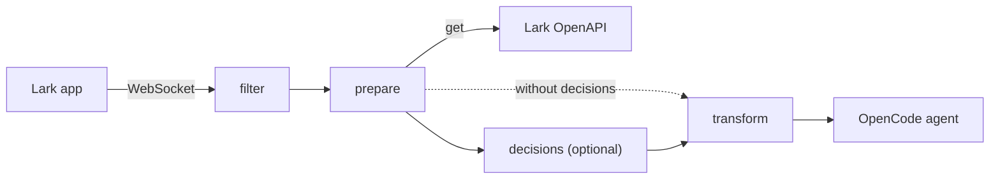

# lark-events-mcp

lark-events-mcp is a local MCP server that sends Lark events to OpenCode. An agent opens a watch on one event, such as `im.message.receive_v1`, and gets one notification for each matching event until the watch stops or expires.



Each event passes through these steps in order:

1. **filter** matches fields of the raw event. Events that do not match are skipped.
2. **prepare** is a script that can read the Lark OpenAPI with `get`, for example to fetch the thread a reply belongs to. It returns the value the next steps see, or null to skip the event.
3. **decisions** is optional. A model configured by the operator answers questions about the value from prepare, such as whether a message needs you.
4. **transform** is a script that reads the event, the value from prepare and the decision answers. It returns the string the agent receives, or null to skip the event.

If any step fails, the watch stops, and the agent sees which step failed and why.

## Why use it

Without this server, an agent learns about new Lark activity only when you paste it in or ask it to poll. With a watch, the session that opened it receives each event as it happens. Some uses:

- **Follow a thread from your current session.** You are fixing a bug that a teammate reported in a Lark thread. Ask the agent to watch `im.message.receive_v1` filtered to that thread. New replies, such as a fresh stack trace or "still broken on staging", reach the session that already has the code open.
- **Hear only about messages that need you.** Ask the agent to watch the chats you care about. The watch fetches thread context and its `decisions` argument asks a model whether each message needs you, for example a direct question or a blocked release. The agent messages you about those and skips the rest. This needs `LARK_DECISIONS_MODEL`.
- **Build a running report.** Ask the agent to watch a channel, such as incident updates or customer feedback, and write a summary when the watch ends. A watch expires after one hour by default, so a longer report needs a new watch each hour.

The server reads events and Lark data. The agent replies or notifies with its own tools, such as `lark-cli`.

## Before you start

The server does not create the Lark app, its permissions, or its event subscriptions, so set those up in the Lark developer console first. It connects to Lark, not Feishu. The package is private and not published to npm.

The server has these limits:

- Delivery is live only. Events that arrive while no watch is open, or while the connection is reconnecting, are lost.
- [Lark sends each event to one WebSocket client](https://open.larksuite.com/document/ukTMukTMukTM/uYDNxYjL2QTM24iN0EjN/event-subscription-configure-/use-websocket) of an app. Any other consumer of the same app, such as `lark-cli event consume` or this server on another machine, splits the events with it.
- Each watch expires after one hour by default.

Every watch's prepare script, and the agent through `get`, can read anything the app's scopes allow. Grant only the scopes your watches need. HR, payroll, and mail scopes expose personal data to the decision model.

To install, give your agent this README and ask it to follow the setup section.

---

## Setup for agents

Follow these steps on the machine that runs the OpenCode service. Ask the user for anything you cannot find.

### Requirements

- Git, Bun 1.4.4, and OpenCode 2.3.0.
- A Lark app with event subscriptions set to WebSocket mode. Ask the user for its app ID, which matches `cli_` followed by 16 hex characters, and its app secret.
- The read scopes each watch needs, such as message history access for `/im/v1/messages`.

### Install

1. Clone the repository and install dependencies at its root:

   ```sh
   git clone https://github.com/LuckUVeryX/oc-plugins.git "$HOME/.local/share/lark-events-mcp"
   cd "$HOME/.local/share/lark-events-mcp"
   bun install --frozen-lockfile
   ```

2. Make `LARK_APP_ID`, `LARK_APP_SECRET`, and Bun's directory on `PATH` available to the OpenCode service. OpenCode reads its own environment, which may differ from the user's shell. Do not write the secret into the config file.

3. Merge this into `~/.config/opencode/opencode.jsonc` and keep the existing settings:

   ```jsonc
   {
     "experimental": { "mcp_events": true },
     "mcp": {
       "servers": {
         "lark-events": {
           "type": "local",
           "command": [
             "bun",
             "{env:HOME}/.local/share/lark-events-mcp/packages/lark-events-mcp/src/main.ts",
           ],
           "cwd": "{env:HOME}/.local/share/lark-events-mcp",
           "pool": true,
           "protocol": "2026-07-28",
           "environment": {
             "LARK_APP_ID": "{env:LARK_APP_ID}",
             "LARK_APP_SECRET": "{env:LARK_APP_SECRET}",
           },
         },
       },
     },
   }
   ```

   If you cloned somewhere else, put the absolute path in `command` and `cwd`. OpenCode expands `{env:HOME}` but not `$HOME`.

   Put this block in the global config only. With `"pool": true`, projects in one OpenCode service share one Lark connection when the command, `cwd`, environment, protocol, and timeout match. A project-level override opens a second connection, and the two connections split the events.

4. Restart the OpenCode service so it reads the new environment and config.

### Optional settings

Add these to the `environment` block if the user wants them.

| Variable                     | Default | Effect                                                                                                                                                                                                                                                                                          |
| ---------------------------- | ------- | ----------------------------------------------------------------------------------------------------------------------------------------------------------------------------------------------------------------------------------------------------------------------------------------------- |
| `LARK_WATCH_MAX_SECONDS`     | `3600`  | How long each watch lasts. Positive integer.                                                                                                                                                                                                                                                    |
| `LARK_DECISIONS_MODEL`       | unset   | Model that answers `decisions` questions, as JSON: `{"providerID":"your-provider","id":"your-model","variant":"optional"}`. Omit `variant` if it is not needed. Without this variable, the server rejects watches that use `decisions`. Each event that passes prepare sends one model request. |
| `LARK_EVENT_TIMEOUT_SECONDS` | `30`    | Time limit for prepare, decisions and transform together. Positive integer.                                                                                                                                                                                                                     |

## Writing a watch

1. Call `get` on each endpoint prepare will read, and look at the real response.
2. Write `prepare`. To pass the event through unchanged, use `return input.event.data`.
3. Add `decisions` if `LARK_DECISIONS_MODEL` is set.
4. Write `transform`. To deliver the value from prepare as it is, use `return JSON.stringify(input.prepared)`.

Both scripts are required.

The `get` path is relative to `/open-apis` and starts with `/`. It cannot contain `..`, `//`, `%`, `\`, a query string or a fragment. Pass query parameters in `query`. The result is the response's `data` field. Fetch additional pages if the endpoint paginates its response.

For `im.message.receive_v1`, replace the open ID below with your own. This prepare skips your messages. It fetches the thread when `thread_id` is present, or the parent message when the reply has `parent_id` but no `thread_id`.

```js
const { sender, message } = input.event.data;
if (sender?.sender_id?.open_id === "ou_your_open_id") return null;
let context = null;
if (message.thread_id) {
  context = await tools["lark-events"].get({
    path: "/im/v1/messages",
    query: { container_id_type: "thread", container_id: message.thread_id },
  });
} else if (message.parent_id) {
  context = await tools["lark-events"].get({
    path: `/im/v1/messages/${message.parent_id}`,
  });
}
return { message, context };
```

Thread IDs have the `omt_` prefix. The returned message's `body.content` is a JSON string; parse it when you need its fields.

The decision model needs to know who "me" is, so the `decisions` input names you. In a live test, the thread reply "be creative" to "send me some memes" scored 0.17 without its thread and 0.89 with it.

Add this `decisions` argument and replace `<your name>`:

```json
{
  "input": [
    {
      "type": "text",
      "text": "I am <your name>. A message needs me if it names me, asks me for something, or continues a conversation that asked me for something. context holds the earlier messages."
    }
  ],
  "questions": [
    {
      "type": "predicate",
      "name": "needs_me",
      "instructions": "Does the latest message need me?",
      "criteria": {
        "true": "It names me, asks me for something, or continues a request made to me.",
        "false": "It is unrelated to me."
      }
    }
  ]
}
```

This transform drops probabilities below 0.7:

```js
const answer = input.result.answers.find((item) => item.name === "needs_me");
if (!answer || answer.type !== "predicate" || answer.probability < 0.7) return null;
return JSON.stringify(input.prepared);
```

A failing step stops the watch with its step, event ID and error. Fix the step and arm a new watch.

## Verify

1. Run `opencode mcp list`. `lark-events` should show `connected`. This checks the MCP connection only.
2. Ask the user which event the app subscribes to, open a watch on it with `watch_mcp_event`, and ask the user to trigger it. An `event` notification confirms delivery from Lark. Then call `stop_watch`.

## Troubleshoot

| Symptom                                                     | Cause                                                                                                            |
| ----------------------------------------------------------- | ---------------------------------------------------------------------------------------------------------------- |
| Server fails to start                                       | `LARK_APP_ID` is missing or malformed, or `LARK_APP_SECRET` is empty. Server logs go to stderr.                  |
| Watch stays open but never becomes active                   | The Lark connection cannot start, often because of a wrong secret. The watch waits until it expires.             |
| Some events arrive, others do not                           | Another consumer of the same app is connected. Find it and stop it.                                              |
| An event never arrives                                      | The app lacks the permission or subscription, or Lark does not deliver that event over WebSocket.                |
| A watch stops with `prepare failed` and `Lark API 99991672` | The app lacks a read scope for the request.                                                                      |
| A watch stops with a timeout                                | The event exceeded `LARK_EVENT_TIMEOUT_SECONDS`. Inspect the named step or increase the limit.                   |
| Memory grows over time                                      | Watches outlive the project that opened them and buffers are unbounded. Run `list_watches` and stop unused ones. |

## Update

Run this at the repository root, then restart the OpenCode service:

```sh
git pull --ff-only
bun install --frozen-lockfile
```
